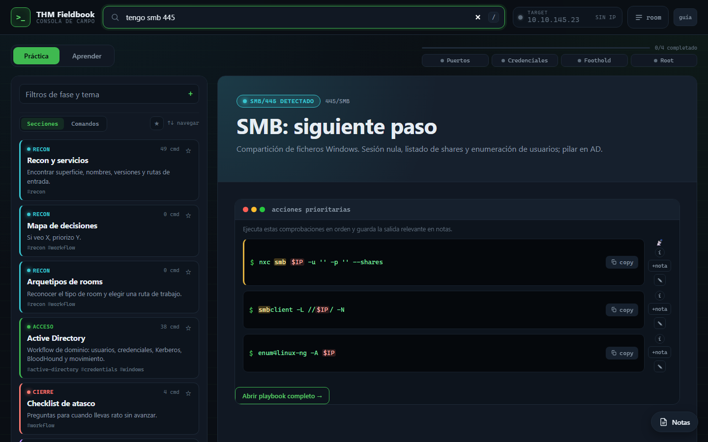
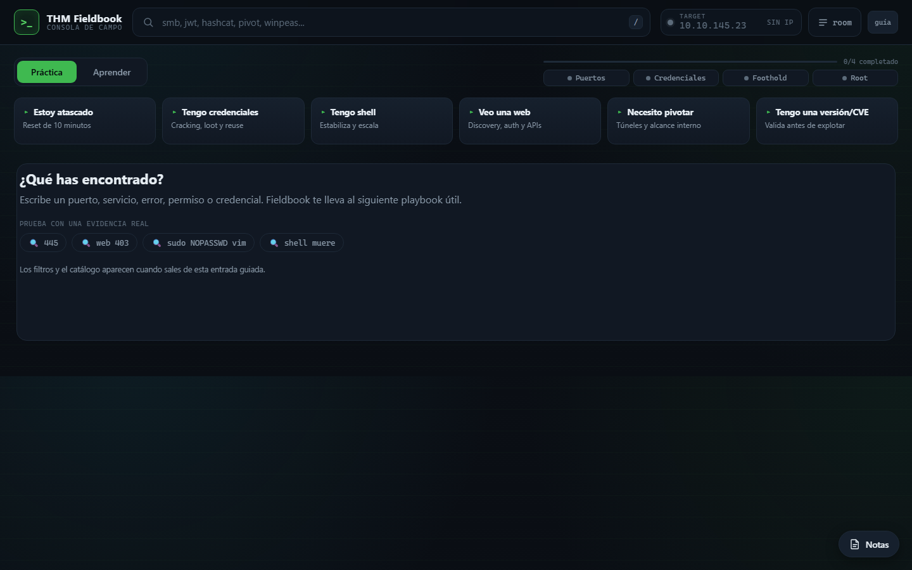
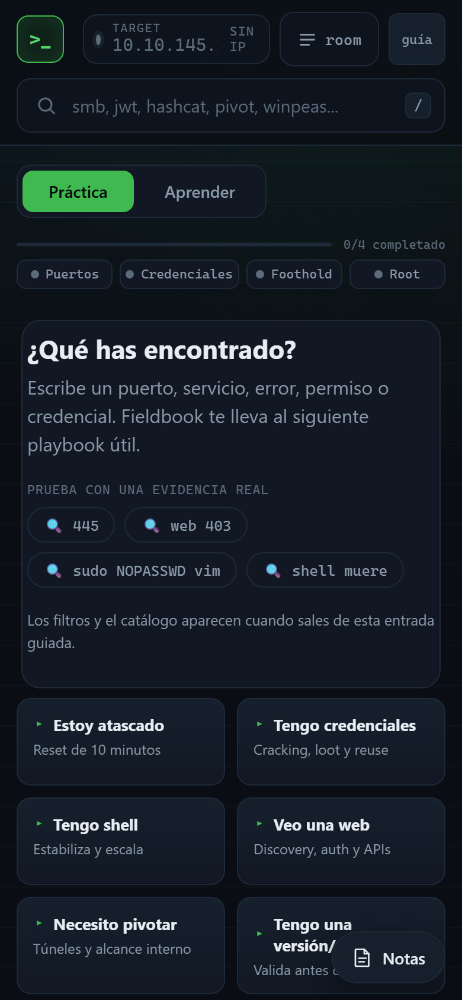

<div align="center">

# `>_` THM Fieldbook

**Consola de campo para rooms de TryHackMe y CTF.**
Escribe lo que has encontrado (un puerto, un error, una credencial) y Fieldbook te lleva a la siguiente comprobación concreta.

[](https://github.com/Urbii22/thm-fieldbook/actions/workflows/pages.yml)
[](https://urbii22.github.io/thm-fieldbook/)
[](LICENSE)


[**Abrir la app →**](https://urbii22.github.io/thm-fieldbook/)

</div>



## Por qué existe

En una room de TryHackMe o un CTF el problema rara vez es no conocer una herramienta: es saber **qué toca hacer ahora** con lo que acabas de ver. Los cheat sheets son listas largas de comandos sin contexto. Fieldbook parte de la **evidencia** (`445`, `web 403`, `sudo NOPASSWD vim`, `shell muere`) y devuelve un playbook corto, ordenado y adaptado a tu objetivo.

No ejecuta nada: rellena `$IP`, `$USER`, `$PASS`… con los datos de tu room, explica para qué sirve cada comando y qué buscar en la salida, y te lo deja listo para copiar y revisar.

## Funcionalidades

| | |
| --- | --- |
| **Búsqueda por intención** | Entiende puertos, servicios, síntomas y frases (`tengo credenciales`, `shell linux www-data`) y prioriza el playbook adecuado. |
| **24 playbooks prácticos** | Recon, web discovery, APIs, inyecciones, SQLi, WordPress, cracking, acceso inicial, privesc Linux/Windows, Active Directory, pivoting, CVE, checklist de atasco… |
| **~440 comandos comentados** | 215 con ficha verificada: objetivo, requisitos, salida esperada, ruido/riesgo y errores comunes. |
| **Modo Aprender** | 12 guías paso a paso y una wiki de 88 conceptos enlazados entre sí, organizados en 19 rutas de aprendizaje. |
| **Gestión de room** | IP, puertos, dominio y usuario; progreso por fases, notas y exportación del writeup en Markdown. |
| **Extras** | Generador de reverse shells, favoritos y recientes, atajos de teclado y funcionamiento offline. |

<p align="center">
  
  &nbsp;
  
</p>

## Stack y decisiones técnicas

- **Web estática sin dependencias**: HTML, CSS y JavaScript nativo (ES modules), sin framework ni paso de build. Se publica tal cual en GitHub Pages.
- **PWA offline-first**: un service worker versionado cachea la app y el contenido; funciona sin conexión durante una room.
- **El contenido es código**: secciones, guías, conceptos y fichas de comandos viven en módulos Python (`tools/`) y se exportan a un único `content.json`. Así el contenido se revisa en diffs y se valida igual que el código.
- **Fichas verificables**: la metadata de cada comando se enlaza por sección y comando normalizado, y el exportador falla si una ficha apunta a un comando que ya no existe.
- **Privacidad por defecto**: todo vive en el navegador. Credenciales, hashes y claves se guardan solo durante la sesión (`sessionStorage`) salvo que actives la persistencia local, y la exportación de una room excluye los secretos.
- **CI que protege el contenido**: cada push ejecuta los tests de Python y JavaScript y comprueba que el `content.json` publicado coincide con lo que genera la fuente.

## Estructura

```text
web/                    App publicada en GitHub Pages
  index.html, app.mjs, styles.css, sw.js, manifest.webmanifest
  js/                   Módulos: búsqueda, ranking, rooms, notas, progreso (+ tests)
  data/content.json     Contenido exportado (generado, se commitea)
tools/                  Fuente del contenido y exportador
  generate_structured_playbook.py   Secciones y comandos
  guides.py, concepts.py            Modo Aprender: guías, conceptos y rutas
  command_metadata.py               Fichas de comandos
  export_web_content.py             Genera web/data/content.json
  generate_thm_playbook.py          Guías temáticas en PDF
tests/                  Tests del exportador
output/pdf/             Guías y playbook en PDF
docs/                   Guía de uso, capturas y notas de desarrollo
```

## Desarrollo local

Requisitos: Python 3.13+ y Node 24+.

```bash
python -m http.server 4599 --directory web
```

Abre <http://localhost:4599>.

### Editar contenido

1. Edita la fuente en `tools/`, nunca `web/data/content.json` a mano.
2. Regenera el contenido:

   ```bash
   python tools/export_web_content.py
   ```

3. Si cambias `app.mjs` o `styles.css`, sube la versión (`?v=` en `index.html`, `VERSION` y `CACHE` en `sw.js`, `APP_VERSION` en `app.mjs`) para que el service worker sirva la nueva.
4. Commitea la fuente y el `content.json` regenerado.

### Tests

```bash
python -m unittest discover -s tests
```

```bash
node --test web/app.test.mjs web/js/*.test.mjs
```

### PDFs

Necesitan `pypdf` y `reportlab`; se escriben en `output/pdf/`.

```bash
python tools/generate_structured_playbook.py
```

```bash
python tools/generate_thm_playbook.py
```

## Documentación

- [Guía de uso](docs/GUIA_DE_USO.md): flujo recomendado y cómo leer los resultados.
- [Guías en PDF](output/pdf/): playbook estructurado y guías temáticas descargables.
- [Notas de desarrollo](docs/dev/): planes de contenido, priorización y auditoría de cobertura PT1.

## Uso responsable

El contenido está pensado para laboratorios (TryHackMe, Hack The Box, CTF) y auditorías con autorización. Lanza cada comando solo dentro del alcance que tengas permitido.

## Licencia

[MIT](LICENSE)
